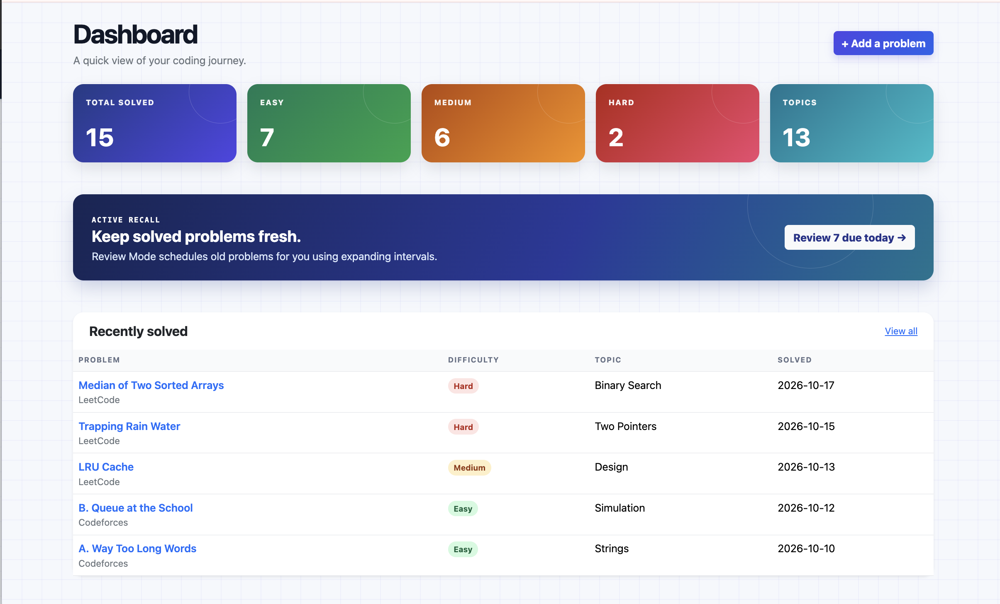
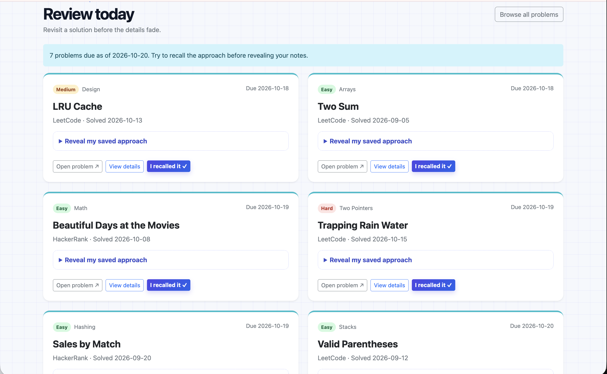
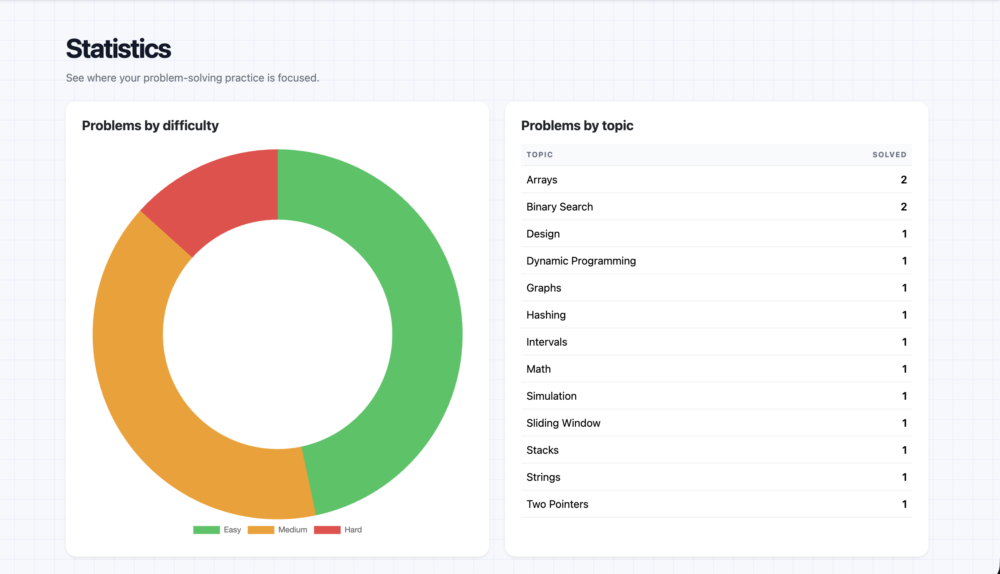

<div align="center">

# </> CodeVault

### Your solved problems deserve a second brain.

A private coding-problem tracker that uses **spaced repetition** and **active recall**, so you actually remember how you solved it.


</div>

---

## 💡 Why CodeVault?

Most of us solve a problem, feel great, and forget the approach two weeks later. A list of solved links doesn't fix that.

CodeVault saves your **own notes** and brings each problem back at the right time, so patterns stick instead of fading.

## 📸 Screenshots

### Dashboard
Your progress at a glance: totals, difficulty breakdown, topics covered, and what's due for review today.



### Review Mode
Recall the approach first. Reveal your notes only when you need them.



### Statistics
See where you're strong and where you're not, by difficulty and by topic.



## ✨ Features

- 🔐 **Private vaults:** secure sign-up and login, and every user's problems stay theirs
- 📝 **Save problems** from LeetCode, HackerRank, Codeforces, or anywhere else, with your own notes
- 🔎 **Search and filter** by name, difficulty, or topic
- 📊 **Dashboard and stats** powered by Chart.js
- 🧠 **Review Mode** with spaced repetition, the heart of the app
- ✅ **Validated inputs** for URLs, dates, and required fields

## 🧠 How Review Mode Works

1. **Solve** a problem and save it with your notes.
2. **Recall** the approach from memory when it comes due.
3. **Reveal** your notes to check yourself.
4. **Mark reviewed** and the next review moves further out.

```text
1 day  →  3 days  →  7 days  →  14 days  →  30 days  →  60 days
```

## 🛠️ Tech Stack

| Layer | Tools |
|---|---|
| Backend | Python, Flask |
| Database | SQLite |
| Frontend | HTML, Jinja, Bootstrap, CSS, JavaScript |
| Charts | Chart.js |
| Security | Werkzeug password hashing, session auth, parameterized SQL |

## 🔒 Under the Hood

- Passwords are hashed, never stored in plaintext
- Every query is scoped to the signed-in user, so no one can view, edit, review, or delete another user's problems
- Parameterized SQL queries protect against SQL injection

## 📁 Project Layout

```text
Codevault/
├── app.py          # Routes, validation, database setup
├── helpers.py      # Login helper
├── templates/      # Jinja pages
├── static/         # CSS and JavaScript
├── tests/          # Automated tests
└── assets/         # README screenshots
```

## 🚀 Run Locally

```bash
git clone https://github.com/ajala-02/Codevault.git
cd Codevault

python3 -m venv .venv
source .venv/bin/activate
python3 -m pip install -r requirements.txt
python3 -m flask --app app run
```

Then open **http://127.0.0.1:5000**.

Want sample data to explore? Run `python3 seed_demo.py` and log in with `demo_user` / `demo1234`.

## ✅ Tests

```bash
python3 -m unittest discover -s tests -v
```

Covers spaced-repetition intervals, review completion, and user ownership protection.

---

<div align="center">

Built for the satisfying moment when a hard problem finally clicks. ✦

</div>
